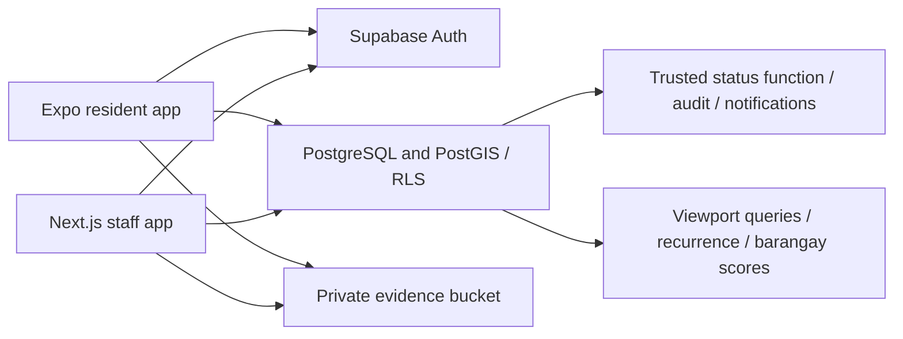

# Architecture

The resident app and staff web app are separate clients. Both authenticate with Supabase Auth and send the user JWT with queries. PostgreSQL RLS is the authorization boundary. Client role checks only control navigation.

Privileged status operations lock the report and validate its current state, jurisdiction, reason, assignment, severity and canonical duplicate reference. The transaction writes status history, assignment history, audit entries and notification records. Raw client updates have no report update policy. Residents cannot set roles; privileged functions check administrator authority. Staff jurisdiction changes require a trusted admin function.

Private reports retain precise coordinates, descriptions and photos. The public RPC returns moderated summaries and coordinates rounded to three decimals, with no identity or attachment fields. Private photo links expire after 60 seconds. Mobile images are resized and re-encoded before upload; bucket MIME and size constraints apply. Direct API uploads still need server-side image decoding/metadata inspection before a wider release.

PostGIS provides spatial indexing and proximity queries. Recurrence candidates are advisory and never merge records. Official verified counts exclude rejected/duplicate records; independent verification remains a human duty. The score uses count, severity sum and oldest age with administrator-controlled weights; it does not infer severity from category. Raw report counts are not a prevalence estimate.

TanStack Query caches requests. Web map queries debounce viewport changes and cap points at 1,000; staff report lists paginate by 20. Community, public discovery, personal report and staff lists paginate. Charts aggregate in SQL across the permitted dataset. Stable report identifiers are persisted before submission and serialized by the submit_report RPC to make ambiguous network retries idempotent. There are no realtime listeners, background tracking, push delivery service, or additional backend servers.

Sources consulted: [Expo SDK reference](https://docs.expo.dev/versions/latest/), [Next.js installation](https://nextjs.org/docs/app/getting-started/installation), [Supabase RLS](https://supabase.com/docs/guides/database/postgres/row-level-security), [Supabase functions](https://supabase.com/docs/guides/database/functions), [MapLibre heatmaps](https://maplibre.org/maplibre-gl-js/docs/examples/create-a-heatmap-layer/).

The Expo browser preview uses the same resident screens and backend with a MapLibre adapter; Android/iOS use native maps. MapLibre worker files are copied from the installed dependency during installation. Notification triggers derive official-response badges from actual staff scope and use generic notification titles. Private notes and evidence remain separately authorized.
