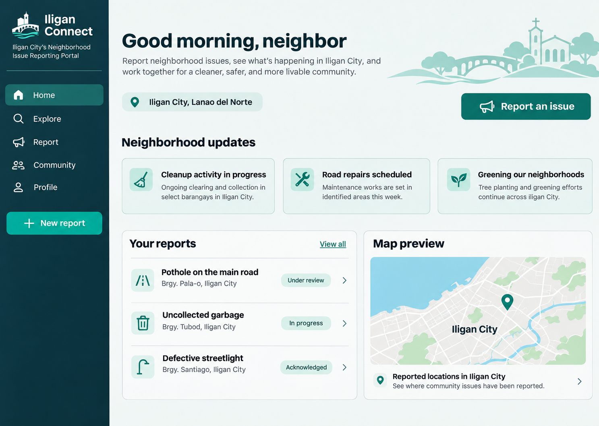
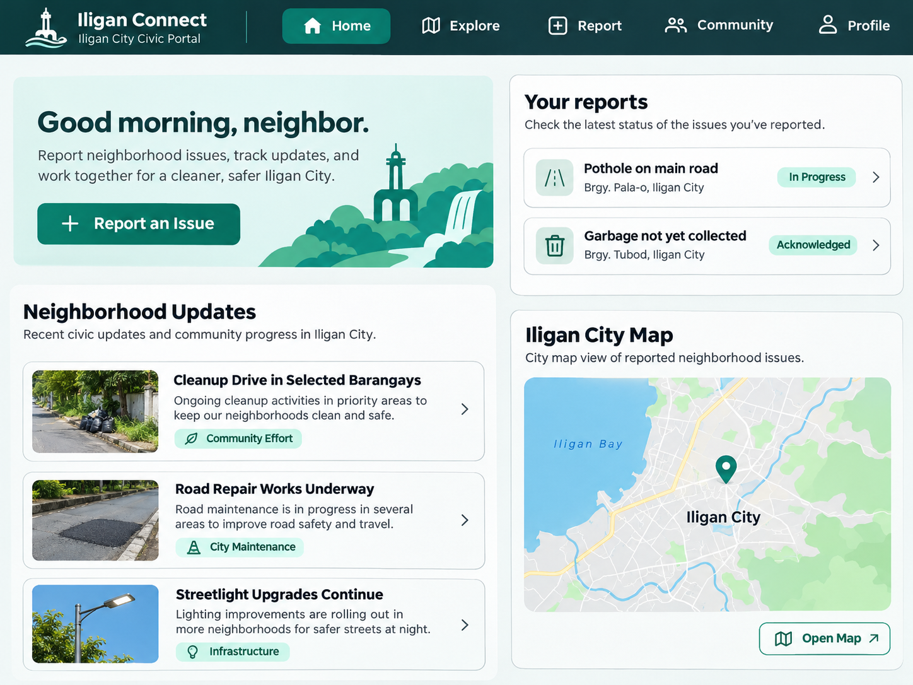
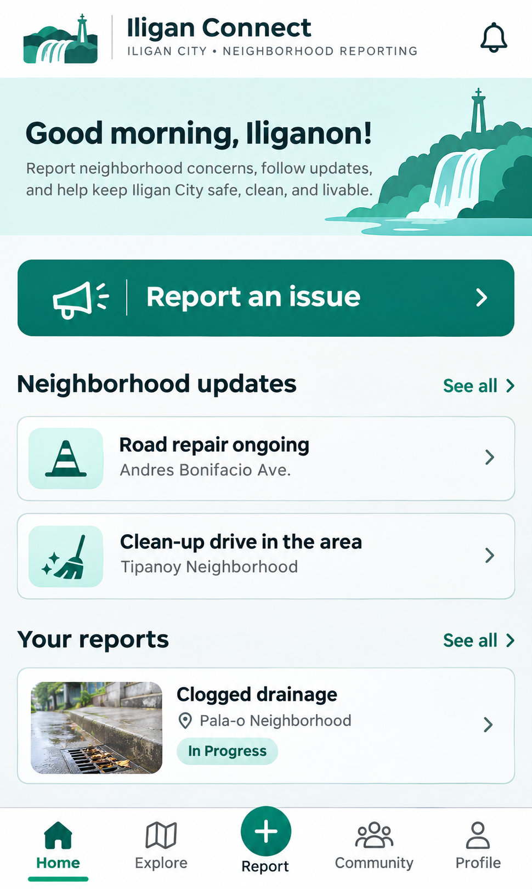
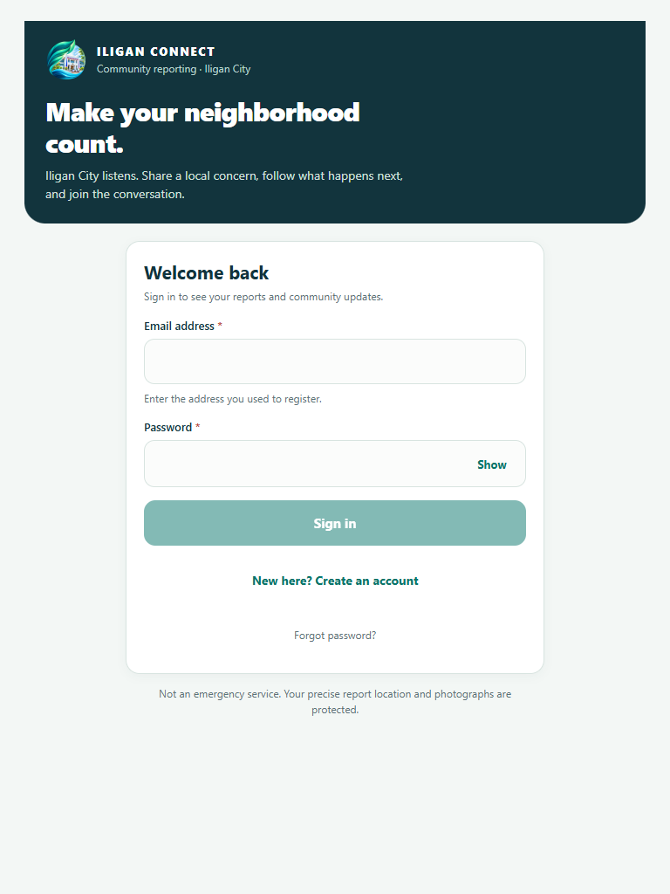
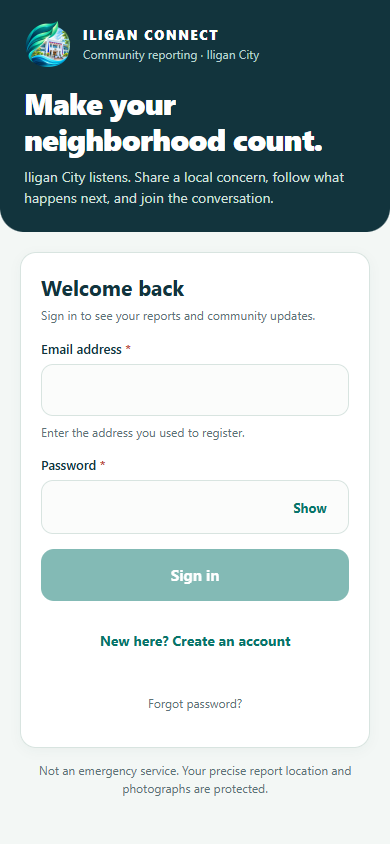

# Resident responsive references

These images set the composition and spacing target for the resident client. Their sample report names and announcements are illustrative; the app must continue to render live data and working controls. Keep the existing icon family, category artwork, and map pins from the app; the generated images do not replace those assets.

## Desktop

## Tablet

## Mobile

## Resident sign-in

Wide desktop sign-in uses a minimalist white split layout: the existing Iligan Connect logo and service story sit in the left column, separated from a simple right-side sign-in form by a fine vertical rule. The form has a teal primary action and a quiet outlined create-account action. Desktop signup hides the story panel and centers the registration card, keeping paired personal-detail and password rows and a full-width email field. Tablet and phone retain the existing stacked design.

## Staff workspaces

See the [staff responsive reference](staff-responsive-reference.md) for the admin, office, and barangay mobile layouts.
