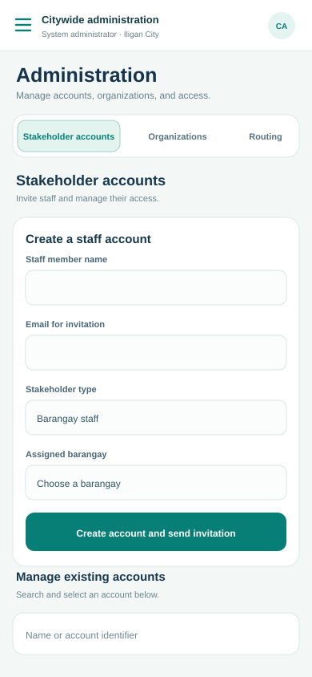
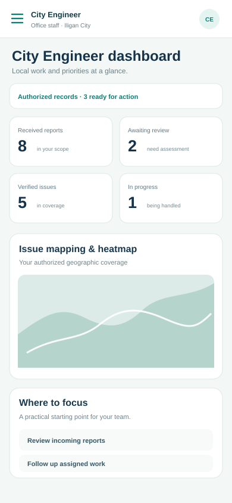
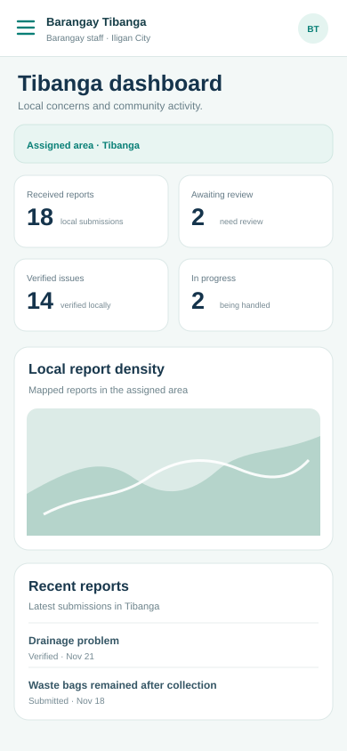

# Staff responsive references

These are layout comps for the existing admin, office, and barangay workspace at a 390 × 844 phone viewport. Their numbers and report descriptions are illustrative. Live data, role permissions, current icons, and map pins remain owned by the app.

## City administration

Administration tabs stay available in a horizontally scrollable strip. Account and configuration sections use one column, and the resident editor uses a full-screen mobile modal.

## Participating office

The office scope stays visible below the heading. Summary metrics use a two-column grid; geographic work and report details stack into a single column. Filters and report detail controls remain touch sized.

## Barangay

Assigned barangay context remains explicit. Local summary metrics, mapping, recent reports, and assigned work appear in a single scrollable column beneath the compact header.

## Device behavior

| Viewport | Workspace layout |
| --- | --- |
| Desktop, 1024 px and wider | Fixed staff navigation rail; broad dashboards and management sections use two columns where their content fits. |
| Tablet, 768–1023 px | Navigation becomes a drawer; admin account and configuration sections stack before they become cramped. |
| Phone, 320–767 px | Drawer navigation, horizontally scrollable admin tabs, single-column forms and work areas, full-screen resident editing, and large touch targets. |

The resident auth page has separate [desktop, tablet, and mobile references](responsive-reference.md#resident-sign-in). These staff comps describe hierarchy and spacing; the implementation continues to render the app's existing icon and map-pin assets.
